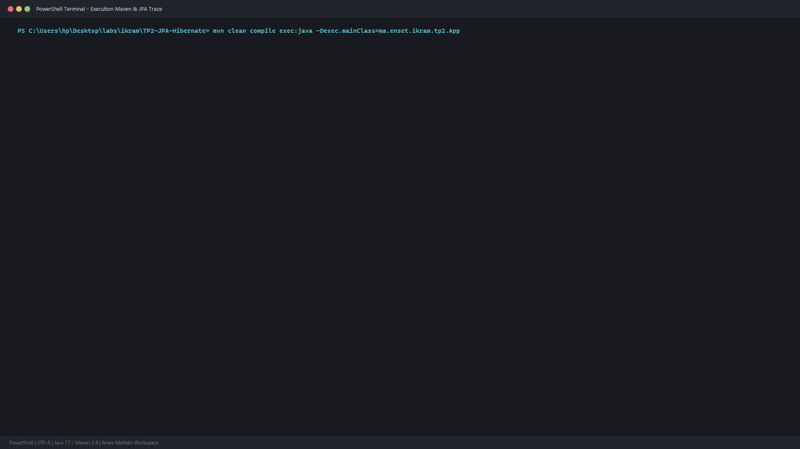

# TP 2 : Gestion des Entites & Cycle de Vie JPA / Hibernate

Projet de manipulation des entites JPA fondamentales avec **JPA 2.2** et **Hibernate ORM 5.6** sur base de donnees **H2 Database**.

Realise par : **Ikram Mellakh**

---

## 1. Entites & Modele de Donnees

### Entite UtilisateurCompte
Cette entite gere les comptes utilisateurs avec leurs roles d'acces et statuts actifs.

### Entite EspaceTravail
Cette entite modelise les salles et espaces professionnels (laboratoires, conferences, box agiles).

---

## 2. Cycle de Vie des Entites Implemente

1. **New / Transient -> Managed (Persist)** : Insertion des utilisateurs et espaces de travail en base.
2. **Managed (Update automatique)** : Modification de la capacite et superficie synchronisee lors du commit.
3. **JPQL Query** : Selection filtre dynamique des espaces disponibles par capacite minimale.
4. **Removed (Delete)** : Suppression physique d'une entite via em.remove().

---

## 3. Execution et Resultats dans le Terminal

Trace complete du cycle de vie et des requetes SQL generees par Hibernate :

---

## 4. Instructions d'Execution

``bash
# Compilation du projet
mvn clean compile

# Execution de l'application
mvn exec:java "-Dexec.mainClass=ma.enset.ikram.tp2.App"
``