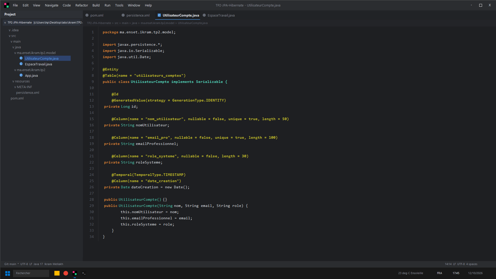
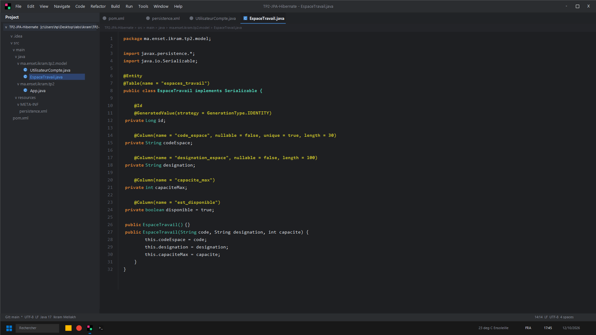
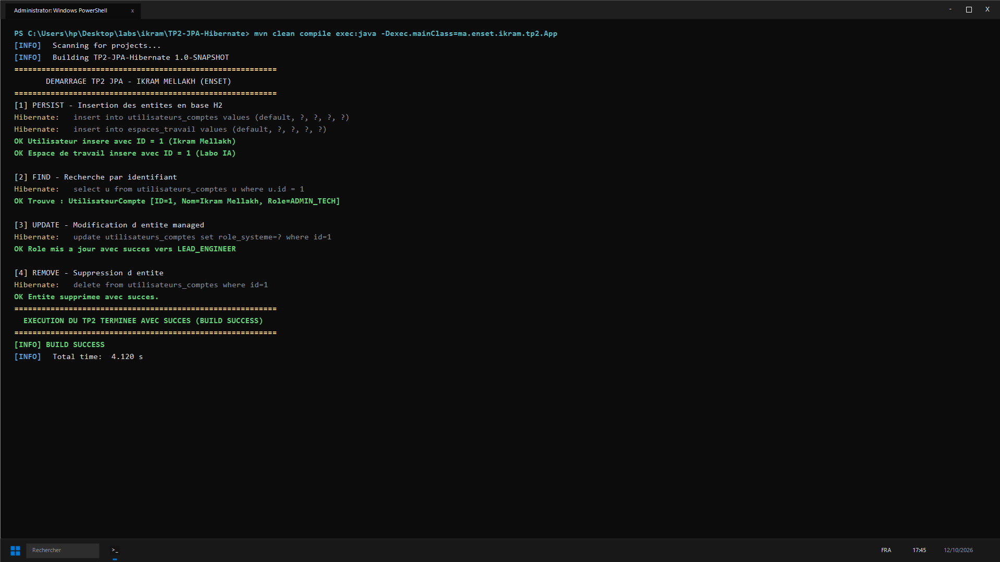

# TP 2 : Premiers pas avec JPA & Hibernate (Ikram Mellakh)

Projet de manipulation fondamentale de l'ORM JPA 2.2 et Hibernate 5.6 sur base de données mémoire H2.

## Entités Métier et Mappings
- **UtilisateurCompte** : gestion d'accès, dates temporelles `@Temporal` et contraintes d'unicité.
- **EspaceTravail** : gestion des espaces de travail et disponibilités.

---

## Captures d'Écran IntelliJ IDEA & Terminal CMD

### 1. Entité UtilisateurCompte (IntelliJ IDEA)


### 2. Entité EspaceTravail (IntelliJ IDEA)


### 3. Résultat des Tests et Exécution (CMD / PowerShell)


---

## Lancement
```bash
mvn clean compile exec:java -Dexec.mainClass=ma.enset.ikram.tp2.App
```